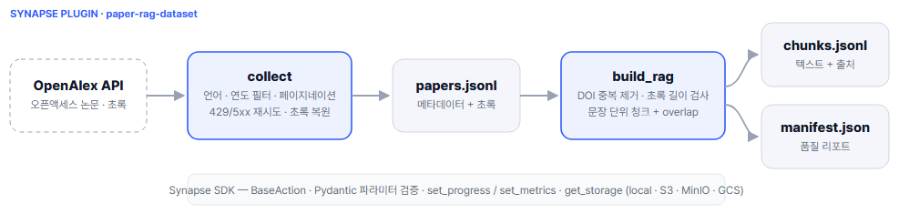
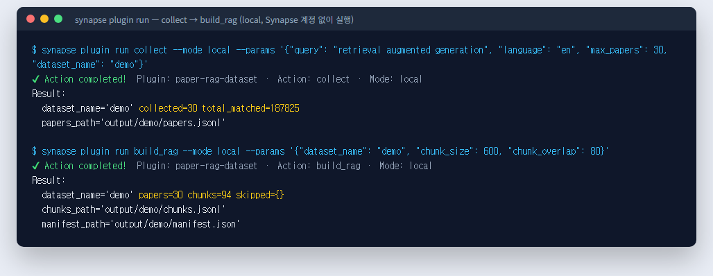
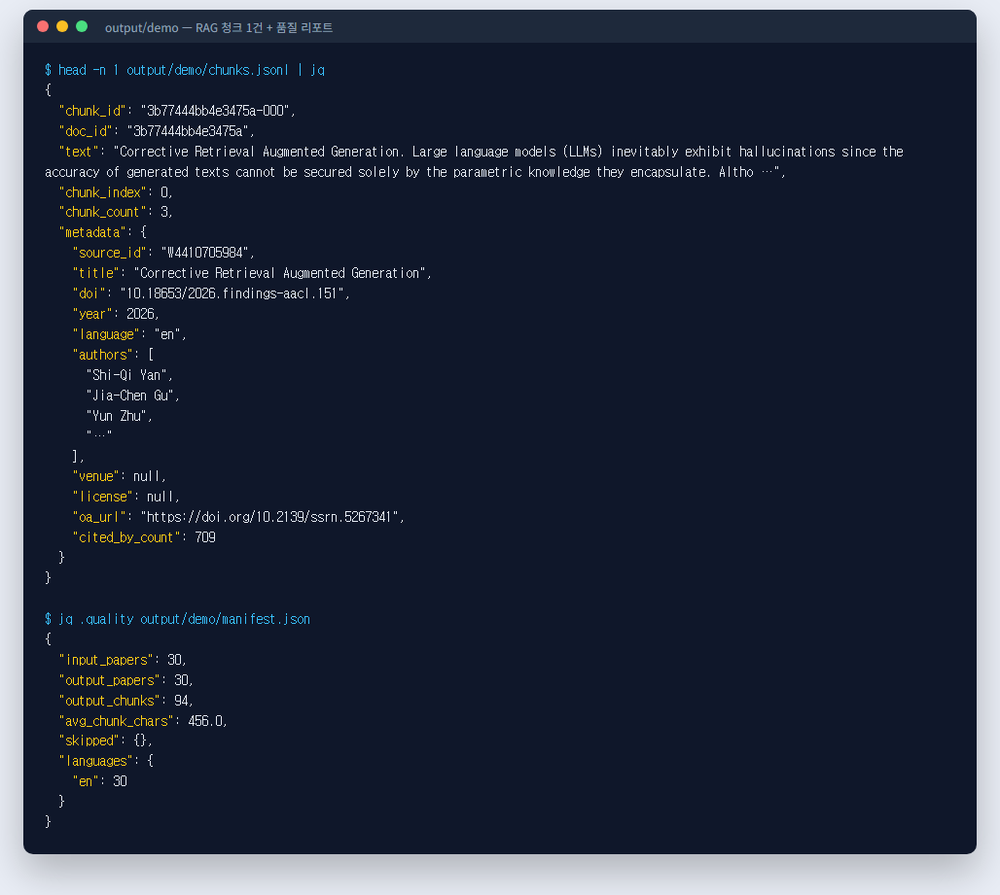
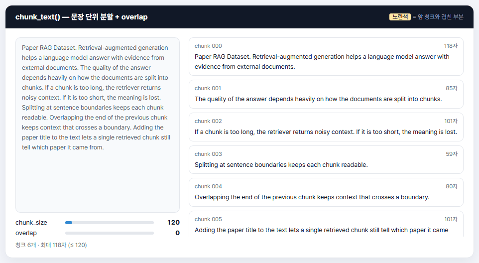
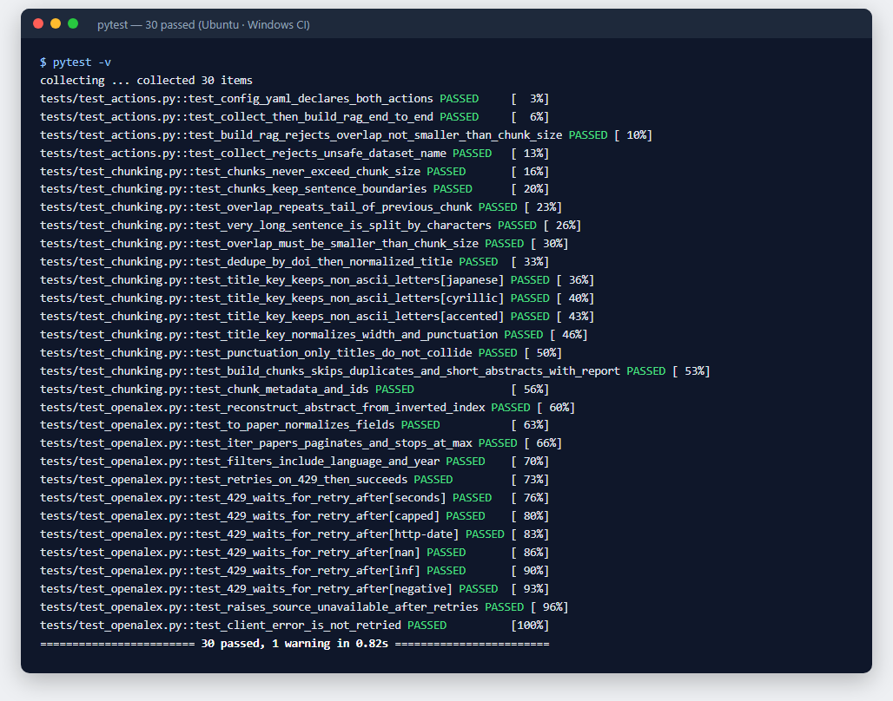

# Paper RAG Dataset — Synapse Plugin

[](https://github.com/vero-zero/synapse-paper-rag-plugin/actions/workflows/test.yml)


> **오픈액세스 논문을 수집해 RAG(검색 증강 생성)에 바로 쓸 수 있는 청크 데이터셋과 데이터 품질 리포트로 바꾸는 [Synapse](https://www.datamaker.io) 플러그인입니다.**
> 데이터메이커가 공개한 [`synapse-sdk`](https://pypi.org/project/synapse-sdk/) v2의 플러그인 구조(config.yaml · `BaseAction` · Storage)를 그대로 따랐습니다.



<br>

## 프로젝트 목적

AI가 문서를 근거로 답하게 하려면(RAG), 문서를 **검색하기 좋은 크기로 자르고, 어디서 온 내용인지 함께 남겨야** 합니다. 그런데 논문 데이터는 그대로 쓰기 어렵습니다.

| 문제 | 이 플러그인의 처리 |
|---|---|
| 초록 길이가 제각각이라 검색 품질이 들쭉날쭉함 | 문장 경계를 지키며 정해진 길이로 분할 |
| 청크 경계에서 문맥이 끊김 | 앞 청크 끝을 겹쳐(overlap) 연결 |
| 청크 하나만 검색되면 어느 논문인지 모름 | 제목을 본문 앞에 붙이고 출처 메타데이터(DOI · 저자 · 연도 · 라이선스) 저장 |
| 같은 논문이 여러 번 수집됨 | DOI(없으면 정규화한 제목) 기준 중복 제거 |
| 몇 건이 왜 빠졌는지 알 수 없음 | 제외 사유 · 언어 분포 · 평균 길이를 품질 리포트로 기록 |

실무에서는 공공기관 연구자 포털에 논문 검색(ScienceON)과 해외 원문복사(RapidILL)를 연동해 **연구자에게 논문을 전달하는 일**을 했습니다. 이 프로젝트는 같은 논문 데이터를 **AI가 검색해 쓸 수 있는 데이터**로 만드는 쪽을 직접 해 보기 위해 시작했습니다.

<br>

## 실행 화면

### 1. 수집 → RAG 데이터셋 생성 (Synapse 계정 없이 로컬 실행)
영어 논문 30편을 수집해 청크 94개를 만든 실제 실행 결과입니다.



### 2. 결과물 — 청크 1건과 품질 리포트
청크마다 임베딩할 텍스트와 출처 메타데이터가 함께 들어가고, `manifest.json`에 품질 지표가 남습니다.



### 3. 청크 분할 동작
`chunk_size`와 `overlap`에 따라 청크가 어떻게 나뉘는지 보여 줍니다. 노란색은 앞 청크와 겹친 부분이고, 문장 중간이나 단어 중간에서 자르지 않습니다.



### 4. 테스트 — 19개 통과 (GitHub Actions: Ubuntu · Windows)



<br>

## 주요 기능

| 액션 | 하는 일 |
|---|---|
| `collect` | OpenAlex에서 **오픈액세스이면서 초록이 있는 논문**만 수집. 언어 · 출판연도 필터, 페이지네이션, 429/5xx 재시도(지수 백오프), 역색인 초록 복원 |
| `build_rag` | 중복 제거 → 짧거나 없는 초록 제외 → 문장 단위 청크 + overlap → 출처 메타데이터 부착 → `chunks.jsonl` · `manifest.json` 생성, Synapse 메트릭 기록 |

**실행 결과**
- 영어 "retrieval augmented generation" 30편 → 청크 94개 (평균 456자, 2026-11-11 실행)
- 한국어 "인공지능 교육" 20편 → 청크 35개

<br>

## 빠른 시작

```bash
# synapse-sdk는 Python 3.12 이상 필요
uv venv --python 3.12 && uv pip install -e . pytest respx

# 수집 → RAG 데이터셋 생성 (Synapse 계정 없이 로컬에서 실행)
synapse plugin run collect   --mode local --params '{"query": "retrieval augmented generation", "language": "en", "max_papers": 30, "dataset_name": "demo"}'
synapse plugin run build_rag --mode local --params '{"dataset_name": "demo", "chunk_size": 600, "chunk_overlap": 80}'

# S3 · MinIO에 저장하려면 storage 파라미터만 바꾼다
#   "storage": {"provider": "s3", "configuration": {"bucket_name": "...", "endpoint_url": "..."}}

pytest   # 19개
```

<br>

## 설계 포인트

- **로직과 플랫폼을 분리했습니다.** 수집(`plugin/core/openalex.py`)과 청크(`plugin/core/chunking.py`)는 SDK를 import하지 않는 순수 Python이고, Synapse 액션(`plugin/collect.py`, `plugin/build_rag.py`)은 파라미터 검증 · 진행률 · 메트릭 · 저장만 맡습니다. 그래서 핵심 로직은 SDK 없이 단위 테스트합니다. 저장을 맡는 `plugin/core/io.py`만 SDK의 Storage를 씁니다.
- **잘못된 요청은 실행 전에 거절합니다.** Pydantic으로 `chunk_overlap < chunk_size`를 검사하고, `dataset_name`은 `../` 같은 경로 조작을 막습니다.
- **저장소를 바꿔도 코드는 그대로입니다.** 결과는 SDK의 `get_storage()`로 저장해, `storage` 파라미터만 바꾸면 로컬 대신 S3 · MinIO · GCS · SFTP에 저장됩니다.
- **데이터 품질을 드러냅니다.** 빠진 건수와 이유, 언어 분포, 평균 청크 길이를 `manifest.json`과 `set_metrics`로 남깁니다.

```
plugin/
├── collect.py        # Synapse 액션: 파라미터 검증 · 진행률 · 저장
├── build_rag.py      # Synapse 액션: 청크 생성 · 품질 리포트 · 메트릭
└── core/             # 핵심 로직 (openalex · chunking은 SDK 없이 단위 테스트)
    ├── openalex.py   # API 클라이언트 · 재시도 · 초록 복원
    ├── chunking.py   # 문장 분할 · overlap · 중복 제거 · 품질 리포트
    └── io.py         # JSONL 입출력 · Storage 업로드 (SDK 사용)
```

<br>

## 기술 스택과 선택 이유

| 기술 | 쓰는 곳 | 선택 이유 |
|---|---|---|
| synapse-sdk v2 | 플러그인 구조 · 저장 · 진행률 · 메트릭 | Synapse 플랫폼에 그대로 올릴 수 있는 형식. 공식 CLI(`synapse plugin create`)로 뼈대 생성 |
| OpenAlex API | 논문 수집 | 무료 공개 API이고 오픈액세스 여부 · 초록 · 라이선스 정보를 함께 제공. 단, 공개 접근이 재배포 허가를 뜻하지는 않으므로 라이선스는 청크마다 `metadata.license`로 남기고 사용 판단은 데이터셋을 쓰는 쪽에 맡김 |
| httpx + 지수 백오프 | API 호출 | 429 · 5xx 같은 일시 오류는 재시도하고, 4xx는 즉시 실패시켜 잘못된 요청을 반복하지 않음 |
| Pydantic v2 | 액션 파라미터 | 잘못된 설정을 실행 전에 거절 |
| JSONL | 결과 파일 | 한 줄에 한 건이라 다른 도구가 줄 단위로 읽을 수 있고, RAG 도구가 바로 읽음. 현재 build_rag는 전체를 메모리에 올려 처리(수집 상한 1,000건 기준) |
| 글자 수 기준 청크 | 청크 분할 | 특정 임베딩 모델의 토크나이저에 묶이지 않게. 대신 토큰 수는 보장하지 않으므로 임베딩 전에 대상 모델 기준으로 확인 필요. 문장 분리는 공백으로 문장을 구분하는 언어(영어 · 한국어 등) 기준 |
| pytest · respx · GitHub Actions | 테스트 · CI | 외부 API 없이 재현 가능한 테스트, Ubuntu · Windows 양쪽 자동 실행 |

**범위에서 뺀 것:** 원문 PDF는 라이선스와 OCR 비용 때문에 1차 범위에서 제외하고 초록만 사용했습니다.

<br>

## 테스트

| 파일 | 내용 |
|---|---|
| [tests/test_chunking.py](tests/test_chunking.py) | 청크 최대 길이, 문장 경계, overlap 연결, 긴 문장 분할, 중복 제거, 품질 리포트, 메타데이터 |
| [tests/test_openalex.py](tests/test_openalex.py) | 초록 복원, 응답 정규화, 페이지네이션, 필터, 429 재시도, 장애 시 예외, 4xx는 재시도하지 않음 |
| [tests/test_actions.py](tests/test_actions.py) | `config.yaml`의 액션 탐색, SDK `LocalExecutor`로 collect → build_rag 전체 실행, 파라미터 검증 실패 |

<br>

## 트러블슈팅

### 1. 한국어 Windows에서만 플러그인 탐색 실패
- **증상:** `config.yaml`에 한글 설명을 넣자 `UnicodeDecodeError`
- **원인:** `synapse-sdk 2026.2.22`가 `config.yaml`을 인코딩 지정 없이 엶(`plugins/discovery.py`의 `path.open()`) → 한국어 Windows에서는 cp949로 읽음
- **해결:** `config.yaml`은 ASCII로만 작성. SDK에서 `encoding="utf-8"`을 지정하면 근본 해결
- **재발 방지:** GitHub Actions에 Windows 러너를 추가해 OS별 문제를 함께 확인

### 2. 파라미터 검증 실패가 다른 예외로 올라옴
- **증상:** 잘못된 파라미터 테스트에서 `ValidationError`를 기대했는데 다른 예외가 발생
- **원인:** SDK `LocalExecutor`가 검증 오류를 `ExecutionError`로 감싸서 전달
- **해결:** 통합 테스트는 `ExecutionError`와 메시지로 검증하고, 순수 로직은 SDK 없이 단위 테스트

### 3. JS로 옮긴 청크 로직이 Python 원본과 1건 불일치
- **증상:** 시연용으로 옮긴 청크 로직을 15개 조건으로 비교하자 1건에서 청크 앞 공백이 다름
- **원인:** overlap이 0이고 조각이 공백으로 시작할 때 Python은 `.strip()` 경로를 타지만 JS는 다른 분기로 빠짐
- **해결:** 분기 조건을 원본과 같게 맞춤 → 15/15 일치

<br>

## 개발 방식

방향과 도메인 설계, 검증 기준은 직접 정했고, 구현과 테스트 작성은 AI 코딩 에이전트(Claude Code)와 나눠 진행했습니다. AI가 만든 코드는 원본 로직과 같은 입력으로 결과를 대조하고, 테스트와 CI로 다시 확인한 뒤 반영했습니다.

## 다음 단계

- [ ] 임베딩 생성과 벡터 검색 품질 평가 액션 추가
- [ ] FastAPI 검색 API로 "검색해서 출처와 함께 돌려주는" 단계 연결
- [ ] 오픈액세스 PDF 원문 청크 (OCR 포함)
- [ ] Synapse `BaseUploadAction`으로 Synapse 데이터셋에 바로 업로드

<br>

---

**만든 사람** · 고테아 · [포트폴리오](https://vero-zero.github.io) · [GitHub](https://github.com/vero-zero)
